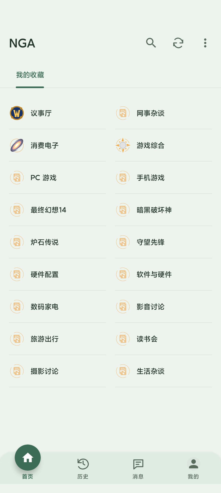
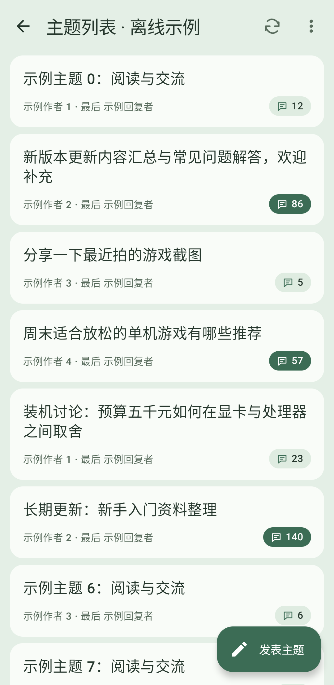
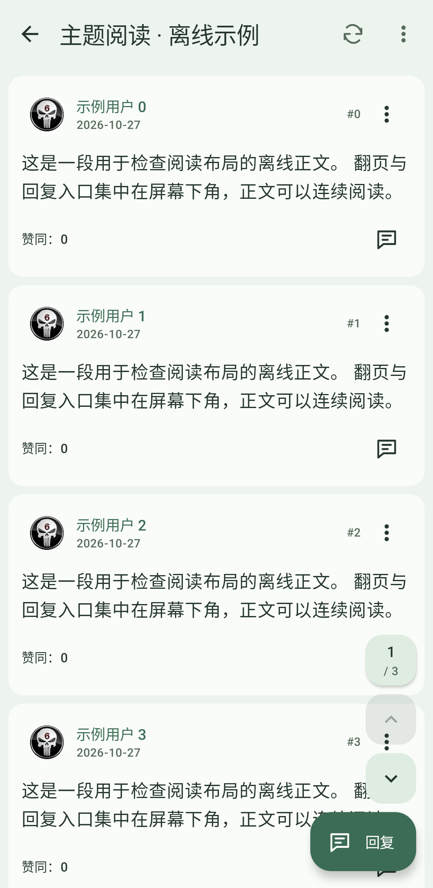
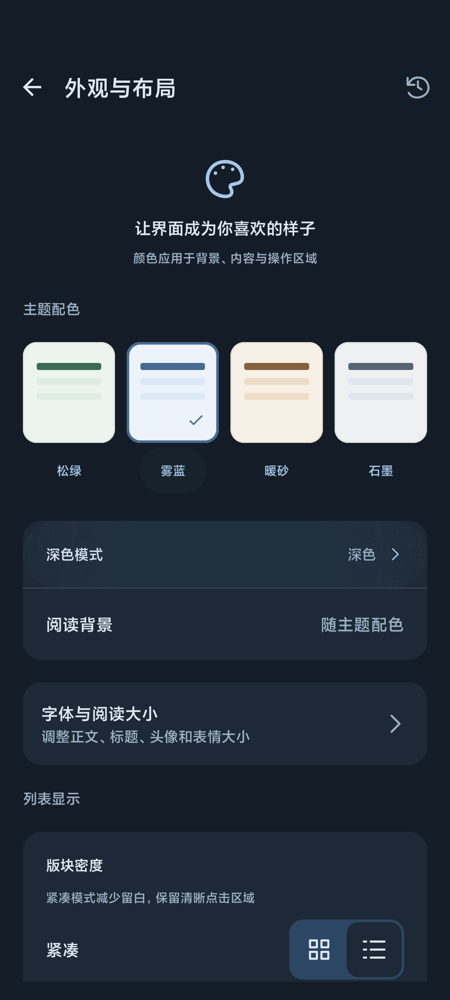

# NGA Android 客户端

NGA Android 客户端开源项目，提供版块浏览、主题阅读、内容搜索、收藏管理、账号管理与私信等功能。项目正在基于 Jetpack Compose 和 Material 3 逐步重构界面，并已升级 Android 构建工具链。

当前版本仅支持 **Android 12（API 31）及以上系统**，不再支持 Android 11 及更早版本。

## 界面预览

<table>
  <tr>
    <td align="center"></td>
    <td align="center"></td>
    <td align="center"></td>
    <td align="center"></td>
  </tr>
  <tr>
    <td align="center">首页</td>
    <td align="center">主题列表</td>
    <td align="center">主题阅读</td>
    <td align="center">配色与深色模式</td>
  </tr>
</table>

截图由设备测试使用离线示例数据生成，不包含真实账号内容。

## 重构进度

下列页面已采用 Jetpack Compose 实现：

| 页面 | 已迁移内容 |
| --- | --- |
| 首页 | 导航抽屉、分类标签、自适应版块网格、账号切换、收藏排序与移除 |
| 版块目录 | 版块筛选、加载状态、失败重试与空状态 |
| 搜索 | 主题、版块及用户搜索，正文搜索选项，用户名与 UID 切换，搜索历史管理 |
| 主题列表 | 主题展示、下拉刷新、分页加载、版块操作及发帖入口 |
| 搜索结果与帖子收藏 | 结果展示、分页加载及收藏删除确认 |
| 登录 | Compose 导航、加载与错误状态、官方网页登录、登录结果校验与取消处理 |
| 发帖、回复与编辑 | 标题与正文输入、格式及表情工具、附件选择与上传、提交确认、退出提示与编辑内容重建恢复 |
| 帖子详情 | Compose 分页、楼层列表、页码与楼层跳转、引用回复、楼层操作及 WebView 正文互操作 |
| 贴条 | Compose 输入与提交状态、长度校验及成功后的详情刷新 |
| 关于 | 版本信息、开源许可、更新入口及贡献者信息 |
| 应用设置 | 分类设置、主题一致的开关和选择弹窗、字号调整、正文预览及缓存确认 |
| 图片浏览 | 左右翻页、双指缩放、双击放大与缩放后拖动，Glide 加载，保存图片 |
| 关键词屏蔽、用户黑名单与账号管理 | 设置页内的子页面：关键词去重与启用开关、移除与清空确认、切换当前账号、调整顺序、查看资料、移除与添加账号 |
| 浏览历史 | 按日分组、长按删除与清空确认，与首页“历史”共用 |
| 回复通知 | 通知类型、时间与未读标记，按时间从新到旧排列，下拉刷新，清空确认 |
| 子版块 | 进入子版块、显示开关，开关状态以论坛返回结果为准 |
| 短消息 | 会话列表与账号切换、会话内容自动翻页、写信与回复校验，发送中不能重复提交 |
| 用户资料 | 基本信息、金钱、声望、管理版块直达、签名显示与修改、按是否本人显示的操作菜单 |
| 我的缓存 | 缓存列表确认删除、导入导出，离线阅读按页码分页 |
| 修改签名与头像 | 内容与地址校验、头像预览，提交结果在页面重建后保留；头像可填写图片地址，或从相册选择后截取（双指缩放、拖动与调整截取框，可选正方形）再按网页“设置头像”的流程上传 |
| 网页浏览 | 加载进度、刷新、复制链接与浏览器打开，返回键回退网页历史 |
| 对话框 | 添加版面、头像、更新内容、由 URL 读取、举报、签名、投票/投注，重建后保留 |

全部页面与对话框均已使用 Compose 绘制，应用模块不再包含 XML 布局。登录认证页面、帖子正文、签名、短消息正文与网页浏览通过 WebView 互操作接入 Compose；详情与离线缓存分页使用 Compose Pager，并通过 AndroidFragment 管理各页业务生命周期。

4.3.0 起各页面的业务逻辑由 ViewModel 承担，原有 MVP（Presenter、Contract、Model 基类）已全部移除。ViewModel 通过 `SavedStateHandle` 读取页面参数，读取请求随页面结束取消，论坛提交在应用级作用域执行，离开页面也不会中途放弃；首次加载只执行一次，页面重建不会重复请求。

详细实现范围及后续验证要求见 [Compose 迁移说明](docs/compose-migration.md)。

## 开发环境

| 配置项 | 版本或要求 |
| --- | --- |
| 最低系统版本 | Android 12，API 31 |
| 编译 SDK | Android 17，API 37 |
| 目标 SDK | Android 17，API 37 |
| JDK | 17 |
| Android Gradle Plugin | 9.4.1 |
| Gradle Wrapper | 9.6.0 |
| Kotlin | 2.4.21 |
| Compose Compiler 插件 | 2.4.21 |
| Compose BOM | 2026.09.00 |
| Android SDK Build Tools | 36.0.0 |

Kotlin 编译采用 AGP 内置支持，Compose Compiler 使用独立插件配置。SDK 版本与公共依赖版本集中定义于根目录 `build.gradle`，依赖仓库统一配置于 `settings.gradle`。

项目已移除 Kotlin Android Extensions、ButterKnife、ARouter 及其编译器、Jetifier、旧 Android Support 库，以及旧滑动返回和悬浮菜单依赖。4.2.0 起另移除 fastjson、RxJava 系列（RxJava 2、rxandroid、rxlifecycle、rxbinding）、Guava、commons-io、PhotoView、load-toast 与 jitpack 仓库，`AsyncTask` 亦不再使用，详见[依赖与异步改造](#依赖与异步改造)。腾讯 Bugly 崩溃上报、友盟统计及 `lib_cloud` 模块已移除，应用不再接入第三方统计或崩溃上报服务；依赖仓库仅使用 Google 与 Maven Central。

## 获取与构建

### 环境配置

1. 获取本仓库，并使用支持当前工具链的 Android Studio 打开项目根目录。
2. 将 Gradle JDK 配置为 JDK 17。
3. 安装 Android SDK Platform 37 与 Android SDK Build Tools 36.0.0。
4. 通过 `ANDROID_HOME` 环境变量或根目录 `local.properties` 文件配置本机 SDK 路径。

`local.properties` 配置格式如下，其中路径应替换为本机实际 SDK 安装位置：

```properties
sdk.dir=/path/to/android-sdk
```

本机路径配置与签名凭据不应提交至版本控制。

### 调试构建

在项目根目录执行：

```sh
./gradlew :nga_phone_base_3.0:assembleDebug
```

Windows 环境应使用 `gradlew.bat` 执行相同任务。

调试版的包名为 `gov.anzong.androidnga.debug`，桌面名称为“NGA测试版”，可与正式版同时安装，数据互不影响。

调试 APK 输出目录为：

```text
nga_phone_base_3.0/build/outputs/apk/debug/
```

### 发布构建

发布签名需由本地发布环境或持续集成环境单独配置。仓库不包含发布证书、签名密码或固定的证书文件路径。未经发布签名的构建产物不得视为可分发的正式安装包。

发布构建通过环境变量 `NGA_KEYSTORE_FILE`、`NGA_KEYSTORE_PASSWORD`、`NGA_KEY_ALIAS` 与 `NGA_KEY_PASSWORD` 读取签名配置；未设置时生成未签名的 `nga_phone_base_3.0-release-unsigned.apk`。

### 自动发布

推送 `v4.1.0` 格式的版本标签后，[发布工作流](.github/workflows/release.yml)会执行单元测试、构建签名发布包，并创建对应的 GitHub Release。发布附件包括 `NGA-<版本号>.apk` 与 `SHA256SUMS.txt`，发布说明取自 `VersionUpgradeTips` 中当前版本代码的更新说明；未找到时使用 GitHub 自动生成的说明。标签带有 `-` 后缀（如 `v4.1.0-beta.1`）时创建预发布，预发布不会出现在应用的检查更新结果中。

首次使用前，需在仓库 Settings → Secrets and variables → Actions 中添加以下 Secrets：

| Secret | 内容 |
| --- | --- |
| `NGA_KEYSTORE_BASE64` | 发布证书文件的 Base64 编码 |
| `NGA_KEYSTORE_PASSWORD` | 证书库密码 |
| `NGA_KEY_ALIAS` | 密钥别名 |
| `NGA_KEY_PASSWORD` | 密钥密码 |

证书文件可用 `base64 -i release.jks | pbcopy`（macOS）或 `base64 -w0 release.jks`（Linux）转换。同一应用的后续版本必须使用同一证书签名，否则无法覆盖安装，证书应妥善备份。

发布步骤：

1. 在根目录 `build.gradle` 中更新 `appVersionName` 与 `appVersionCode`，并添加对应的 `TIPS_<版本代码>` 更新说明。
2. 提交并推送后，创建与 `appVersionName` 一致的标签并推送：`git tag v4.1.0 && git push origin v4.1.0`。

标签与 `appVersionName` 不一致或缺少签名 Secrets 时，工作流会直接失败，不创建发布。签名校验后，工作流还会检查安装包包含各模块的关键类，缺失时同样不发布。库模块的 release 构建不开启混淆，避免删除模块代码；4.1.0 与 4.2.0 正式版曾因此启动闪退，已在 4.2.1 修复。

应用“关于 → 检查更新”读取本仓库 GitHub 的最新正式发布（不含草稿与预发布），按数字比较发布标签与 `appVersionName`。发布标签应采用 `v4.1.0` 或 `4.1.0` 格式，发布说明会显示在更新提示中。版本号与版本代码定义于根目录 `build.gradle`，版本代码按 `主版本×1000 + 次版本×100 + 修订号` 递增，并需在 `VersionUpgradeTips` 中添加对应的 `TIPS_<版本代码>` 更新说明。

## 测试与静态检查

执行调试构建、单元测试和 Android Lint 检查：

```sh
./gradlew :nga_phone_base_3.0:assembleDebug \
  :nga_phone_base_3.0:testDebugUnitTest \
  :nga_phone_base_3.0:lintDebug
```

报告输出位置：

| 报告 | 路径 |
| --- | --- |
| 单元测试报告 | `nga_phone_base_3.0/build/reports/tests/testDebugUnitTest/index.html` |
| Lint 报告 | `nga_phone_base_3.0/build/reports/lint-results-debug.html` |

截至 2026 年 10 月 29 日（全部页面与对话框迁移到 Compose 后），调试构建、应用模块 265 项单元测试与 Android Lint 检查已通过，93 项设备交互测试已在 Android 12 模拟器和 Android 16 实机上全部通过；2026 年 10 月 28 日（4.3.0）时 75 项设备交互测试已在 Android 16 实机上全部通过。2026 年 10 月 26 日时，Android 12 模拟器上的 41 项设备交互测试已通过。另通过临时在线测试验证两个异常主题及第二页能够转换为原生楼层数据。Lint 检查未发现错误，仍存在历史警告。单元测试覆盖版块筛选、搜索历史、导航规则、登录 Cookie 解析、编辑器选区处理、分页边界、主题响应格式兼容、链接识别、论坛收藏解析、账号隔离、各页面 ViewModel、论坛提交协议（合成响应）及图片域名转换；设备测试覆盖提交与退出确认、编辑内容重建恢复、登录取消、分页、引用入口、离线详情加载、长正文高度测量、正文导航、兼容响应转换、错误后页面保留及登录网页框架的高度适配、论坛收藏管理、菜单状态、同步重试、密度持久化、底部分页、整页主题换色、截断响应来源切换、网页归一化后的原生正文转换与缓存读取，以及设置子页面、浏览历史、回复通知、子版块、短消息详情解析、音视频地址，短消息列表/会话/写信、用户资料、我的缓存与离线阅读、修改签名与头像、网页浏览外壳和各对话框（含重建后保留输入）。

Lint 保持错误阻断。由于当前 AGP 的 SARIF 报告器存在数组越界问题，项目暂时关闭 SARIF 导出，保留 HTML、文本与 XML 报告。

小屏横屏、1.5 倍字体与关闭系统动画配置下的 4 项核心交互测试亦已通过。Android 17 模拟器仍存在启动挂起问题，尚未完成该版本的设备交互验证。现有设备测试不提交真实帖子或回复。发布前仍需使用测试账号验证实际认证、账号切换、服务端提交、附件上传、图片保存、缓存导入导出及通知行为，并在 Android 12 与 Android 17 设备上检查深浅色主题、较大字体与横屏布局。

设备交互测试需连接 Android 12 及以上设备或模拟器后执行：

```sh
./gradlew :nga_phone_base_3.0:connectedDebugAndroidTest
```

设备测试报告位于 `nga_phone_base_3.0/build/reports/androidTests/connected/debug/index.html`。

## 项目结构

```text
.
├── nga_phone_base_3.0/   # Android 应用模块
├── lib_common/          # 公共组件与工具
├── lib_core/            # 核心功能模块
├── lib_network/         # 网络功能模块
├── docs/                # 重构与迁移文档
├── gradle/              # Gradle Wrapper
├── build.gradle         # 构建插件、SDK 与公共版本配置
└── settings.gradle      # 模块声明与依赖仓库配置
```

Compose 界面与公共主题位于应用模块的 `gov.anzong.androidnga.ui.compose` 包中。现有 Activity、Fragment 与业务层通过 `setContent` 或 `ComposeView` 接入 Compose。

## 平台适配

- 采用边到边窗口布局，并处理系统栏、屏幕开孔及软键盘 Insets。
- 返回操作接入 `OnBackPressedDispatcher`，移除旧全屏滑动返回实现。
- 通知使用不可变 `PendingIntent`，并处理 Android 13 及以上系统的通知权限。
- 图片保存与缓存导出使用 `MediaStore`，不再声明或请求 `WRITE_EXTERNAL_STORAGE` 权限。
- 附件选择与缓存导入使用系统文档选择器，通过 `ContentResolver` 读取所选文件。
- 页面导航采用显式 `Intent` 映射，保留既有页面参数及登录保护规则。

## 界面与外观

首页与版块目录提供标准和紧凑两种显示模式，默认采用紧凑布局。紧凑模式使用小图标和单行名称，减少卡片留白；模式选择在重启后保留，大字体下自动调整列数。

刷新、同步、重试和恢复默认等工具栏操作使用图标，并保留无障碍说明及长按提示。主题阅读页的分页固定于底部，支持回到首页、前后翻页、按页码或楼层跳转及回复入口，并适配左手模式。

“外观与布局”统一从侧边栏“应用”分组进入，提供松绿、雾蓝、暖砂和石墨四种配色及浅色、深色、跟随系统三种模式。主题联动覆盖页面背景、内容区域、分隔线、底栏及正文网页；恢复默认操作需要确认。原有固定 Compose 配色不再覆盖用户设置。

[设计预览](docs/previews/nga-redesign-v1.png)与[已实现的紧凑首页截图](docs/previews/implemented/compact-home.png)可供对照；实现及验证范围见 [界面布局重构说明](docs/interface-redesign.md)。

## 版块收藏同步

首页“我的收藏”仅显示当前账号的论坛收藏，已移除独立的本机收藏、排序和清空入口。登录完成后自动读取论坛收藏；进入首页时会检查同步状态，相邻成功请求之间设有 60 秒间隔。用户可通过“同步论坛收藏”立即更新。

版块菜单的“收藏到论坛”“取消论坛收藏”及按编号添加版块均直接提交至论坛。首页“管理收藏”支持取消论坛收藏。操作经论坛确认成功后，首页、版块菜单与离线缓存共同更新；失败时保留原状态并显示错误。未登录时引导登录，操作处理中禁止重复提交。

论坛收藏缓存仅用于离线展示，按账号隔离。切换账号或退出登录时不会显示其他账号的缓存；旧账号的未完成请求不会覆盖当前账号数据。

已在 Android 16 实机上确认论坛收藏可读取并显示。协议、缓存与验证范围见 [版块收藏同步说明](docs/forum-favorites-sync.md)。

## 导航与设置

侧边栏分级显示，账号与应用分开：

- **账号头部**：当前账号头像、昵称与 UID，点击进入个人资料；下方提供切换账号（显示其他账号头像）与添加账号。未登录时显示默认头像与登录按钮。头像来自本机记录的账号头像地址，未记录时显示昵称首字。
- **账号**：以分组卡片显示，包含“消息”（回复通知及未读角标、短消息）与“我的内容”（我的主题、我的回复、收藏夹、我的缓存）。未登录时仅保留我的缓存，其余入口合并为登录提示。
- **论坛工具**：查找版块、按编号添加版块、通过链接打开及搜索用户等入口。
- **应用**：位于底部分隔线下方，以外观与布局、设置、关于三格入口显示。

“外观与布局”不再同时出现在首页操作菜单和设置列表中；“关于”保留单一侧栏入口。

设置页使用与主界面一致的主题背景、内容卡片、开关、弹窗及工具栏，分为阅读与浏览、主题列表、消息通知、发帖、账号与屏蔽、网络与存储。字体调整在相同的 Compose 页面内完成。原有设置键值保持兼容，通知声音选项随回复提醒开关联动；缓存清理仅在确认后执行，并在实际操作完成后提示结果。关键词屏蔽、用户黑名单与账号管理是设置页内的子页面，返回键回到设置并保留列表位置；删除与清空前均需确认。账号列表按保存顺序持久化，移除的账号重启后不再出现，移除或调整其他账号时当前账号保持不变。

## 正文字号与楼层卡片

普通文字与富文本共用正文缩放设置，系统字体放大按照 Compose 的字号换算同步到网页正文，避免原生文字与网页额外缩放造成字号差异。网页使用移动端视口及统一的基础字体、行高，保留正文主动指定的颜色和特殊字号。阅读缩放变更后即时更新两种正文。

普通楼层与热点回复均使用 14 dp 圆角卡片，左右各保留 8 dp 边距，卡片内部水平留白为 12 dp。卡片背景和热点分区背景随主题变化。

## 热点回复

主题首页存在论坛热点回复时，在主楼与后续正常楼层之间显示“热点回复”分区。热点区使用当前主题的容器背景及对应文字颜色，随四种配色和浅色、深色模式同步变化，富文本正文背景亦保持一致。

热点回复保留原楼层号、作者、正文、图片、客户端标识及引用、楼层操作入口；正常位置的回复仍按原顺序显示。热点不参与正常楼层计数与分页，跳转楼层时定位正常位置。未提供热点数据时隐藏分区。JSON、XML 和普通网页中的热点正文经统一转换，并随主题原始数据缓存。

## 主题滚动优化

无图片、链接及特殊格式的普通回复使用 Compose 原生文本排版；包含引用、表情、附件、编辑提示、签名等内容的楼层保留富文本渲染。正文网页容器支持列表复用，楼层高度在离屏后保留，尺寸通知进行合并及去重，并校验通知所属文档，减少滚动过程中的创建、销毁和重复布局。性能排查及验证范围见[主题滚动性能记录](docs/topic-scrolling-performance.md)。

## 正文图片兼容

`*.nga.178.com` 图片域名已无法访问，`img.ngacn.cc`、`img4.ngacn.cc` 仅重定向至这些域名。正文、附件、短消息与签名中的相对图片地址及旧附件域名统一转换为 `https://img.nga.cn`，帖子中的视频与音频同样使用该域名；表情、版块图标等 `ngabbs` 路径使用 `https://img4.nga.cn`。以图片形式插入的旧表情按路径匹配内置图片，与域名无关。正文图片与图库共用地址规则，支持 JPG、WebP 等格式；网页图片标签的单引号、双引号及额外属性不再影响图片地址收集。外部图片域名保持原值，关闭图片加载时仍显示占位图。

针对主题 47786601，已在 Android 阅读组件中验证实际 JPG、WebP 图片的加载与解码，并通过地址转换和相关正文回归测试。在线诊断仅使用公开主题，临时测试组件未安装到用户手机。

## 发帖与论坛操作

发帖、回复、引用、编辑及贴条参照 SNGA 的协议提交：先请求 `post.php` 预检取得 `auth`，再以 UTF-8 表单提交并附带 `access_uid`/`access_token`；回复与编辑只按主题编号提交。短消息、头像、投票及子版块显示开关同样经统一的请求层提交至当前论坛域名。所有提交不跟随重定向、不自动重试，结果按论坛返回的提示判断；无法确认结果时提示用户刷新查看，不当作成功，避免重复提交。

发帖表情插入网页版表情代码（如 `[s:ac:茶]`），与网页版一致。

## 登录网页适配

登录页继续使用 NGA 官方网页完成认证。应用根据 WebView 的实际视口高度调整嵌套登录框架，避免部分设备因百分比高度解析为零而仅显示灰色背景，并在视口变化后重新适配。登录主文档与表单文档加载失败时显示错误及重试入口。

已在 Android 12 模拟器中验证嵌套表单显示与视口变化，并在已连接的 Android 16 设备上确认官方登录页面可见。认证信息由用户在设备上输入，页面显示检查不代替完整认证验证。

## 主题加载与链接处理

主题详情加载失败时保留当前阅读页面，并显示错误原因及重新加载入口。应用不再因响应解析失败而自动打开浏览器、关闭详情页或尝试其他账号。主题请求使用兼容请求标识；在响应不完整或格式不兼容时，依次尝试 JSON、普通网页、XML 与备用 XML，单次加载最多四次请求。网页正文与启动数据归一化后进入统一校验、原生楼层转换及缓存流程，避免依赖重复请求同一接口。登录、权限及网络错误直接在应用内反馈。

正文中的 NGA 主题、回复与版块链接按实际域名和路径识别，支持相对地址、协议相对地址及既有域名别名，并保留分页、作者筛选和楼层定位参数。用户主动打开外部网站或选择详情菜单中的浏览器入口时，仍可使用相应浏览器功能。

实现依据与回归验证范围见 [主题加载修复说明](docs/topic-opening-fix.md)。

## 依赖与异步改造

4.2.0 版本未改变界面功能，主要替换已停止维护的依赖：

- **JSON 解析**：fastjson 替换为 `lib_common` 中自有的 `NgaJson`。宽松解析、类型转换及本地存储格式由特征测试固定，屏蔽用户、屏蔽词、浏览历史、版块收藏缓存等既有本地数据可直接读取。说明见 [fastjson 替换说明](docs/fastjson-migration.md)。
- **异步任务**：RxJava 与 `AsyncTask` 替换为 Kotlin 协程与 Flow。网络接口改为挂起函数 `NgaApi`，Java 调用方继续使用原有回调；请求随页面销毁取消，页面事件通过 `SharedFlow` 投递。说明见 [RxJava 替换说明](docs/rxjava-migration.md)。
- **网络与图片**：Retrofit 升级至 3.0.0，OkHttp 升级至 4.12.0，Glide 升级至 4.16.0。
- **图片浏览**：图片浏览页改用 Compose 实现分页与缩放，移除 PhotoView 及 jitpack 仓库。
- **其他**：移除 Guava、commons-io、load-toast 及未使用的代码。

4.3.0 版本继续清理：Presenter 全部迁移至 ViewModel，删除未使用的旧版主题列表、搜索历史、版块分类分页、账号密码登录及 `LauncherSubActivity`，剩余后台线程改用协程，`startActivityForResult`、`ProgressDialog` 等已弃用接口替换为 Activity Result API 与 Material 对话框。

改造过程中修正了个人资料加载无法取消、签名与保存图片可重复提交、登录对话框事件订阅未释放等问题。登录、发帖、上传、短消息、点赞、收藏、举报、签名、通知及保存图片等服务端操作无法在自动化测试中提交，发布前需使用测试账号人工检查。

## 参考资料

- [MNGA 主题请求与响应兼容实现](https://github.com/BugenZhao/MNGA/blob/main/logic/service/src/fetch.rs)
- [Jetpack Compose 官方文档](https://developer.android.com/compose)
- [Compose 渐进式迁移策略](https://developer.android.com/develop/ui/compose/migrate/strategy)
- [AGP 内置 Kotlin 迁移指南](https://developer.android.com/build/migrate-to-built-in-kotlin)
- [Android Gradle Plugin 9.4 发布说明](https://developer.android.com/build/releases/agp-9-4-0-release-notes)

## 开源许可

本项目采用 GNU General Public License v2，具体条款见 [LICENSE](LICENSE)。第三方依赖的许可要求应分别遵循其对应的许可文件。
